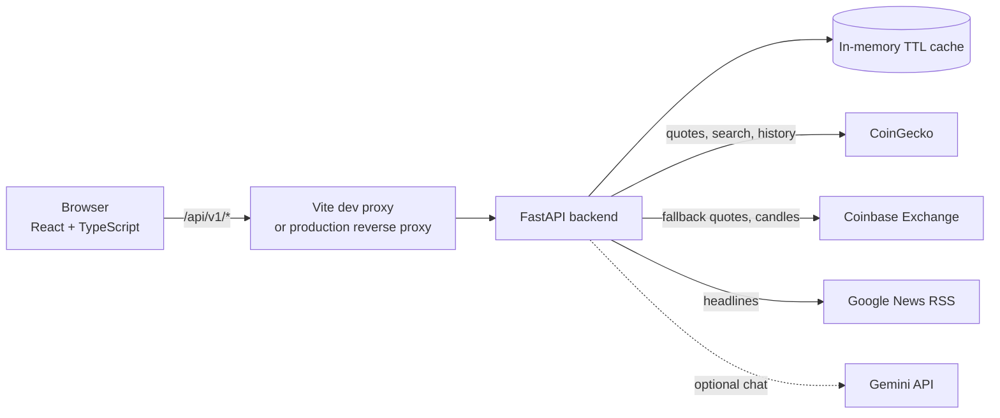

# Architecture and design decisions

How Fin • Crypto Research Buddy is built, and why. Each decision lists the tradeoff, so this doubles as a guide for explaining the project.

## The system at a glance

- **Frontend** (`frontend/`): a single-page React app. One page, local component state, no router and no state library.
- **Backend** (`backend/`): FastAPI in four layers: `routes` (HTTP) → `schemas` (Pydantic validation) → `services` (logic) → `tools` (outside data).
- **No database yet.** Nothing is stored on the server. The user's optional research preferences live in their own browser, and only if they opt in.

## Following one request: "Analyze Bitcoin"

1. The user submits the form. `handleAnalyze` in `frontend/src/App.tsx` cancels any in-flight request, bumps a version counter and calls `analyzeCrypto` in `src/lib/cryptoApi.ts`.
2. That sends `POST /api/v1/crypto-analysis` (`backend/app/routes/crypto_analysis.py`). Pydantic validates the body; a bad body returns a uniform `INVALID_REQUEST` error.
3. The route checks the asset ID, then calls `CryptoResearchService.analyze` inside a 14-second `asyncio.wait_for` deadline.
4. `analyze` (`services/crypto_research.py`) fetches the market **snapshot** and the **news** *in parallel* with `asyncio.gather`.
5. `CryptoDataProvider` (`tools/crypto_data.py`) serves each from its TTL cache or calls the provider. CoinGecko is primary; Coinbase is a fallback for eight mapped coins.
6. `answer_question` builds topic-by-topic answers using plain rules (keyword matching on the question). Risks, sources and warnings are added, and the response is assembled.
7. Back in the browser, hand-written validators check the response shape. If the version counter still matches (the user did not cancel or resubmit), the results render. The price chart then loads its own history with a separate `GET /api/v1/crypto-history/{id}` call.

## Design decisions

### 1. Snapshot answers are rule-based, and the AI chat is separate and labeled
- **Choice:** the research cards come from deterministic code. The Gemini chat is a different feature, clearly labeled as AI.
- **Why:** numbers in a finance tool must never be invented. Rules return exactly what the data provider reported, are free to run, and are easy to test.
- **Tradeoff:** the topic matching is keyword-based (`answer_question`), so it can miss phrasing. The app says so in its warnings instead of pretending otherwise.
- **Next step:** replace the regexes with a classifier or an LLM constrained to the retrieved data.

### 2. The chat treats the model as untrusted
`backend/app/services/crypto_chat.py` wraps a single Gemini call with guardrails:
- **Allowlisted model and strict JSON schema output** (`in_scope`, `answer`, `source_ids`, `limitations`).
- **Citation checking:** every cited `source_id` must exist in the evidence the server retrieved; otherwise the answer is rejected.
- **Prompt-injection stance:** the system prompt treats user text, chat history and provider data as *data, never instructions*. The model has no tools and cannot fetch URLs.
- **Secret checks:** the API key must not appear in the context or the output.
- **Fail-closed configuration:** chat is disabled unless a key *and* an explicit free-tier confirmation are set; an invalid daily limit disables it.
- **Cost and abuse limits:** a daily call cap and a two-slot semaphore with a 0.2-second admission timeout, so a busy chat fails fast instead of piling up.
- **Privacy:** the optional research profile is never sent to the chat.
- **Honest limits:** citation IDs prove a source exists, not that it supports the claim. The cap is per process and resets on restart. Model scope behavior has not been evaluated against a live model yet (see the proposed evaluation harness in `IMPROVEMENTS.md`).

### 3. Several data providers, with a conservative fallback
- **Choice:** CoinGecko first; Coinbase Exchange only for eight coins whose product IDs are explicitly mapped. Google News supplies headlines only, not article text.
- **Why:** free APIs rate-limit and go down. A fallback keeps the page useful. Mapping IDs by hand avoids the classic bug of guessing a ticker pair and showing the wrong token.
- **Tradeoff:** fallback data lacks market cap and aggregate volume, and the response says so.

### 4. Caching with per-key locks and hard deadlines
- **Choice:** an in-memory TTL cache (60 seconds for quotes, longer for slow-changing data) with a lock per key, capped at 128 entries. Every provider call has a 4-second wall-clock deadline, and endpoints have a 14-second one.
- **Why:** when many requests ask for the same key at once, only one calls the provider and the rest wait for its result (this avoids a "cache stampede" on a rate-limited API). Deadlines keep a slow provider from hanging the page.
- **Tradeoff:** the cache is per process and evicts oldest-first (FIFO, not LRU). It does not survive restarts or work across multiple workers; a shared cache such as Redis would.

### 5. Async I/O with pooled connections, and a separate pool for the model
- **Choice:** `httpx.AsyncClient` instances are created once in the app's lifespan. Market data and the model use *different* pools.
- **Why:** reusing connections is faster, and a slow model call can't use up the connections that market data needs.

### 6. One error format for everything
- **Choice:** every failure returns `{"error": {"code", "message", "request_id"}}` through shared exception handlers in `app/main.py`.
- **Why:** the frontend can handle errors in one place, and a request ID gives support something to quote.
- **Next step:** the ID is generated but not yet written to logs, so it can't be traced. Fixing that is on the improvement list.

### 7. Frontend: small and defensive
- **Stale-response protection:** `AbortController` plus a version counter mean a slow older response can never overwrite a newer one, and cancelling really cancels.
- **Hand-written response validators** at the API boundary: the frontend does not trust the network. The tradeoff is manual upkeep of types that mirror the backend schemas, so a generated client from `/openapi.json` is on the improvement list.
- **No chart library:** charts are native SVG with an accessible text table. The production bundle is about 63 KB gzipped.
- **Privacy by default:** preferences are stored in the browser only with a checked consent box, and reset removes them.
- **Accessibility:** a skip link, live regions for status and errors, reduced-motion support.

### 8. Testing and automation
- **Backend:** an autouse fixture blocks all real HTTP transports, so tests cannot reach the network or spend quota. Providers are mocked.
- **Frontend:** tests run through a small custom hook harness rather than a browser or jsdom. It is fast and dependency-free, but it is not a real browser, which is why real-browser checks are still a gap.
- **CI:** GitHub Actions runs backend tests and frontend lint, typecheck, tests and build. `main` is protected: changes arrive by pull request, and both checks must pass.

## Known limitations
See the "Known limitations" section of the README and `docs/IMPROVEMENTS.md` for the ranked list. The biggest: no persistence, no per-user rate limiting, per-process cache and chat cap, and no live evaluation of the AI chat.

## Talking about this project

**30-second pitch.** "Fin is a full-stack crypto research dashboard. A React/TypeScript frontend talks to a FastAPI backend that pulls market data from CoinGecko with a Coinbase fallback. Research answers are deterministic so numbers are never invented, and there's a separate, heavily guarded Gemini chat. It has tests, CI, and a protected main branch."

**Three problems worth telling stories about**
1. *Stale responses.* A slow older request could overwrite a newer one. Solved with cancellation and a version counter.
2. *Rate-limited free APIs.* Solved with caching, per-key locks so concurrent requests share one fetch, deadlines, and a fallback provider.
3. *Safely using an LLM.* Solved by treating the model as untrusted: strict schema, validated citations, no tools, fail-closed config, and an honest list of what that does *not* guarantee.

**Questions to expect, and where to look**
- "Why not just use an LLM for everything?" → decision 1.
- "How do you stop prompt injection?" → decision 2, including its limits.
- "What happens when CoinGecko is down?" → decisions 3 and 4.
- "How would this scale?" → decision 4's tradeoff (shared cache, rate limiting, database), then the improvement list.
